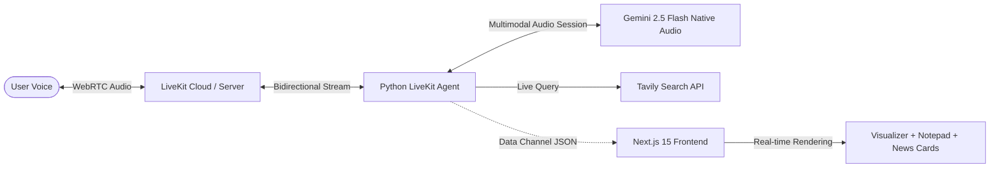

# Neha – Your Personal AI Voice Companion 🎙️✨

> **An expressive, human-like voice AI companion who chats naturally, brainstorms creative ideas, and helps you research anything in real time.**

[](https://nextjs.org/)
[](https://livekit.io/)
[](https://ai.google.dev/)
[](https://tavily.com/)
[](https://opensource.org/licenses/MIT)

---

## 🌟 Meet Neha

**Neha** is designed to feel like a real friend and thought partner rather than a rigid corporate bot. Whether you want to talk about your day, brainstorm startup ideas, solve complex problems, or dig up fresh news and research on the web, Neha is always there to talk, listen, and assist.

- **Human-Like Real Voice**: Native multimodal audio with natural inflection, tone, and pacing (powered by Gemini 2.5 Native Audio & Aoede voice).
- **Thought & Brainstorming Partner**: Bounce thoughts, debate concepts, or explore creative angles together in fluid dialogue.
- **Instant Web Research**: Connected to the live web via Tavily to fetch real-time facts, current events, and live sources.
- **Interactive Live Notepad**: Neha automatically pins important notes, thoughts, and collected data to your screen notepad as you speak.
- **Visual News Cards**: Live articles and research headlines pop up directly onto the frontend data feed.
- **Bilingual & Culturally Warm**: Speaks English and Nepali naturally.

---

## 🏗️ Architecture & How It Works



1. **Audio Streaming**: Your browser streams your microphone audio to LiveKit over WebRTC with ultra-low latency.
2. **Native Audio Processing**: The Python backend connects the room stream directly to **Gemini 2.5 Flash Native Audio preview**, eliminating intermediate Speech-to-Text and Text-to-Speech latency.
3. **Function Tools**:
   - `search_web`: Performs real-time web searches and streams parsed article cards to the UI.
   - `show_news`: Fetches top headlines for any requested topic.
   - `write_to_notepad`: Dynamically writes key points into the interactive sidebar notepad.
4. **Interactive UI**: Audio visualizers (aura/wave/bars), real-time transcription, microphone controls, and live dynamic sidebars keep you engaged.

---

## 📁 Repository Structure

```
neha-livesearch/
├── backend/                       # Python LiveKit Voice Agent
│   ├── livesearch.py              # Neha agent logic, Gemini voice model, tools
│   ├── requirements.txt           # Python dependencies
│   ├── .env.example               # Backend environment template
│   └── README.md
├── frontend/                      # Next.js 15 Web Application
│   ├── app/                       # App Router & /api/token endpoint
│   ├── components/                # Neha UI, Visualizers, Audio Bars, Notepad, News
│   ├── hooks/                     # Custom LiveKit WebRTC audio & control hooks
│   ├── public/                    # Avatar images and assets
│   ├── package.json
│   ├── .env.example               # Frontend environment template
│   └── README.md
└── README.md
```

---

## 🚀 Quick Start

### 1. Prerequisites

- **Node.js** 18+ and **npm**
- **Python** 3.10+ (Python 3.11 or 3.12 recommended)
- **LiveKit Cloud** credentials (or self-hosted LiveKit server)
- **Google Gemini API Key** (with Gemini Multimodal Live API access)
- **Tavily API Key** (for live search and news)

---

### 2. Backend Setup

1. Navigate to the `backend` directory:
   ```bash
   cd backend
   ```

2. Create and activate a Python virtual environment:
   ```bash
   python -m venv venv
   # Windows:
   venv\Scripts\activate
   # macOS/Linux:
   source venv/bin/activate
   ```

3. Install required packages:
   ```bash
   pip install -r requirements.txt
   ```

4. Create your local environment file:
   ```bash
   cp .env.example .env.local
   ```

   Fill in your API keys in `backend/.env.local`:
   ```env
   LIVEKIT_URL=wss://your-project.livekit.cloud
   LIVEKIT_API_KEY=your_livekit_api_key
   LIVEKIT_API_SECRET=your_livekit_api_secret
   GOOGLE_API_KEY=your_gemini_api_key
   TAVILY_API_KEY=your_tavily_api_key
   ```

5. Start the Neha Agent:
   ```bash
   python livesearch.py dev
   ```

---

### 3. Frontend Setup

1. In a separate terminal, navigate to the `frontend` directory:
   ```bash
   cd frontend
   ```

2. Install dependencies:
   ```bash
   npm install
   ```

3. Create your local environment file:
   ```bash
   cp .env.example .env.local
   ```

   Fill in your configuration in `frontend/.env.local`:
   ```env
   LIVEKIT_URL=wss://your-project.livekit.cloud
   LIVEKIT_API_KEY=your_livekit_api_key
   LIVEKIT_API_SECRET=your_livekit_api_secret
   ```

4. Run the development server:
   ```bash
   npm run dev
   ```

5. Open [http://localhost:3000](http://localhost:3000) in your browser and click **Start Call** to begin chatting with Neha!

---

## ⚙️ Environment Variables Reference

| Variable | Description | Where It's Used |
| :--- | :--- | :--- |
| `LIVEKIT_URL` | WebSocket URL for your LiveKit instance (`wss://...`) | Backend & Frontend |
| `LIVEKIT_API_KEY` | LiveKit project API key | Backend & Frontend |
| `LIVEKIT_API_SECRET` | LiveKit project API secret | Backend & Frontend |
| `GOOGLE_API_KEY` | Google Gemini API key (supports Gemini 2.5 Native Audio) | Backend |
| `TAVILY_API_KEY` | Tavily Search API key for web search & news | Backend |

---

## 💬 Usage Examples

Once connected, try saying:
- *"Hey Neha! How was your day?"*
- *"I have this idea for a mobile app, can we brainstorm the core features together?"*
- *"What's happening in tech news today? Show me some headlines."*
- *"Could you search what the weather is like in Kathmandu right now?"*
- *"Save this thought in my notepad: Follow up with Anand regarding the research report."*

---

## 🛡️ License

This project is licensed under the [MIT License](LICENSE).
